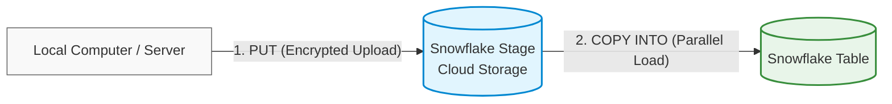
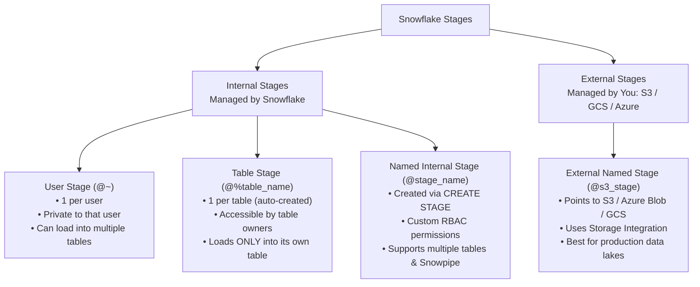

# Snowflake Stages & Table Stages — Complete Reference Notes

> **Quick Summary:** Snowflake is a cloud-native data warehouse and cannot read files directly from your local machine. All bulk data loads follow a two-step process: **Stage the file in cloud storage first**, then **load it into a table using `COPY INTO`**. A **Table Stage (`@%table_name`)** is an implicit, zero-setup internal stage created automatically for every table.

---

## 1. Why Does Snowflake Need a Stage Instead of Direct Upload?

Unlike a local database running on your laptop, Snowflake runs entirely in the cloud (AWS, Azure, or GCP).



### Key Architectural Reasons
* **Cloud Separation:** Snowflake compute clusters (Virtual Warehouses) cannot reach into your local filesystem. Files must first land in cloud object storage (`PUT`).
* **Parallel Processing:** Virtual warehouses read staged files across multiple compute nodes simultaneously. Direct row-by-row `INSERT` statements are slow and not designed for bulk loads.
* **Zero-Compute Uploads:** Running `PUT` to upload files into an internal stage uses **zero virtual warehouse credits**. You only pay for compute when running `COPY INTO`.
* **Validation & Preview:** Staging allows you to inspect raw files (`SELECT $1, $2 FROM @%my_table`) and run `VALIDATION_MODE` before committing rows to your table.
* **64-Day Load History (Deduplication):** Snowflake remembers which staged files have already been loaded into a table for 64 days, preventing duplicate loads if `COPY INTO` is re-run.

*(Note: When you click **"Load Data"** in the Snowsight UI for small files up to 250 MB, Snowflake still uses a stage behind the scenes—it simply automates `PUT` and `COPY INTO` for you.)*

---

## 2. What Is a Table Stage (`@%table_name`)?

Every time you create a table in Snowflake, Snowflake **automatically creates an implicit internal stage** tied specifically to that table.

* **Syntax:** `@%<table_name>` (e.g., if your table is `CUSTOMERS`, its table stage is `@%CUSTOMERS`).
* **Cost:** Costs **$0** until you actually upload files into it.
* **Visibility:** Does not show up in `SHOW STAGES` because it is not a standalone database object.

### Why Does It Exist If We Already Have Named Internal Stages?
If you already use a Named Internal Stage (`@my_stage`), **you do not need to use the table stage**. However, the table stage exists as a **built-in convenience shortcut**:

1. **Zero DDL / Setup:** No `CREATE STAGE` statement or `CREATE STAGE` privilege required.
2. **Automatic Cleanup:** When you `DROP TABLE`, Snowflake automatically deletes its table stage and any files inside it (no orphaned files left behind).
3. **No Schema Clutter:** Avoids creating dozens of stage objects for quick one-off imports or dev/test loads.
4. **Automatic Ownership Permissions:** Anyone with `OWNERSHIP` on the table can immediately upload and manage files in `@%table_name` without separate `GRANT` statements.

---

## 3. Types of Snowflake Stages Compared



| Feature / Attribute | Table Stage (`@%my_table`) | Internal Named Stage (`@my_stage`) | External Stage (`@my_s3_stage`) |
| :--- | :--- | :--- | :--- |
| **Creation** | Automatic with `CREATE TABLE` | Manual (`CREATE STAGE`) | Manual (`CREATE STAGE`) |
| **Storage Location** | Snowflake-managed cloud | Snowflake-managed cloud | Your AWS S3 / Azure / GCS |
| **Target Tables** | **Only** its own table | Any number of tables | Any number of tables |
| **Access Control** | Tied to table `OWNERSHIP` | Granular `GRANT` per role | Granular `GRANT` + Cloud IAM |
| **Supports `PUT` Command?** | Yes (from local machine) | Yes (from local machine) | **No** (files placed directly in S3) |
| **Supports Snowpipe?** | No | Yes | Yes |
| **Lifecycle** | Dropped when table is dropped | Independent object | Independent object |

---

## 4. Practical SQL Examples

### Scenario A: Using a Table Stage (Quick Local CSV Load)
*Use this when you have a local file on your machine and want to load it into one table without creating extra stage objects.*

```sql
-- 1. Create the table (Snowflake automatically creates @%customers in the background)
CREATE OR REPLACE TABLE customers (
    id INT,
    name STRING,
    email STRING
);

-- 2. Upload local file to the table stage (Run via SnowSQL CLI, Python Connector, etc.)
PUT file:///Users/yourname/Downloads/customers.csv @%customers;

-- 3. Inspect files currently sitting in the table stage
LIST @%customers;

-- 4. Load data into the table (Notice: no FROM clause is required!)
COPY INTO customers
FILE_FORMAT = (TYPE = 'CSV' SKIP_HEADER = 1);

-- 5. Optional: Remove the file from the table stage after loading to save storage
REMOVE @%customers;
```

---

### Scenario B: Loading from AWS S3 (Table Stage Is Bypassed)
*Important Rule: A Table Stage **cannot** connect to S3. When your data lives in S3, use an **External Named Stage** and load straight into the table. The table stage (`@%sales_data`) sits empty and unused.*

```mermaid
flowchart LR
    S3[(AWS S3 Bucket
s3://my-bucket/sales/)] -- "Referenced via
Storage Integration" --> ES[@my_s3_stage
External Stage]
    ES -- "COPY INTO sales_data" --> TBL[(sales_data Table)]
    TS[@%sales_data
Table Stage] -. "Exists automatically,
remains empty & unused" .- TBL
    
    style TS stroke-dasharray: 5 5,fill:#f5f5f5,stroke:#999
```

```sql
-- 1. Create the target table (@%sales_data is auto-created, but we won't touch it)
CREATE OR REPLACE TABLE sales_data (
    order_id INT,
    amount NUMBER(10,2),
    order_date DATE
);

-- 2. Create an External Stage pointing to your S3 bucket
CREATE OR REPLACE STAGE my_s3_stage
    URL = 's3://my-bucket/sales/'
    STORAGE_INTEGRATION = my_s3_integration;

-- 3. Load directly from S3 into the table
COPY INTO sales_data
FROM @my_s3_stage
FILE_FORMAT = (TYPE = 'CSV' SKIP_HEADER = 1);
```

---

## 5. Quick Decision Cheat Sheet (1-Year Refresher)

* **Is your file already in AWS S3 / Azure Blob / GCS?**
  $
ightarrow$ Use an **External Named Stage** (`@my_s3_stage`). Ignore the table stage.
* **Are you building a production pipeline, loading multiple tables, or sharing stages across roles?**
  $
ightarrow$ Use an **Internal Named Stage** (`@my_internal_stage`). Ignore the table stage.
* **Do you just want to quickly push a local CSV into a single dev/ad-hoc table without creating extra objects?**
  $
ightarrow$ Use the **Table Stage** (`@%table_name`) that already came free with your table!
