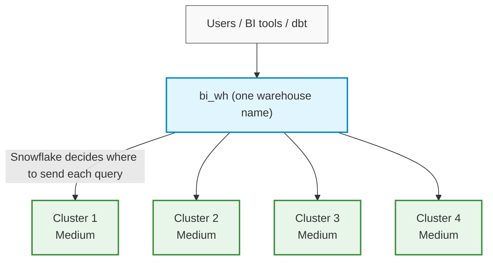

# Snowflake Virtual Warehouse — Scale Up vs. Scale Out (Multi-Cluster Warehouses)

> **Quick Summary:** **Scale up** makes one warehouse bigger so a heavy query runs faster. **Scale out** adds more clusters of the same size behind one warehouse so many queries can run at the same time without queuing. Scale out is done with a **multi-cluster warehouse**, it is **off by default**, and it needs **Enterprise Edition or higher**.

---

## 1. Scale Up vs. Scale Out

| | Scale Up (Vertical) | Scale Out (Horizontal) |
|---|---|---|
| **What changes** | Warehouse size (e.g., Small -> Large) | Number of clusters (e.g., 1 -> 4) |
| **Solves** | Slow, heavy queries | Too many queries at the same time |
| **Symptom to look for** | Disk spilling, long-running joins | Queries waiting in a queue |
| **Makes one query faster?** | Yes | No |
| **How it happens** | Manual (`ALTER WAREHOUSE ... SET WAREHOUSE_SIZE`) | Automatic, between the min and max you set |
| **Edition** | All editions | Enterprise Edition or higher |

**Supermarket analogy:**
* **Scale up** = a faster cashier, so one big trolley is finished sooner.
* **Scale out** = more billing counters open, so the queue is shorter.

---

## 2. Warehouse vs. Cluster

This is the part that is easy to mix up.

* **Warehouse** = just a name, like `bi_wh`. It is the front door that users connect to. It has no compute power by itself.
* **Cluster** = the real machines (servers with CPU and memory) that actually run the queries.

**The warehouse contains the clusters.** A cluster does not contain a warehouse.

* A normal warehouse has **1 cluster** behind the name.
* A multi-cluster warehouse has **many clusters** behind the same name.



All queries arrive at the one warehouse name, and Snowflake spreads them across the clusters:

1. Query A goes to Cluster 1.
2. Query B goes to Cluster 1 while it still has room.
3. Query C finds Cluster 1 full, so it goes to Cluster 2.
4. And so on, up to the maximum cluster count.

**Bank analogy:** The branch is the warehouse and the counters are the clusters. Customers all walk into the same branch, and staff send each one to a free counter. When the crowd grows, the bank opens more counters; it does not build another branch.

---

## 3. How to Set Up Scale Out

### Create a multi-cluster warehouse
```sql
CREATE OR REPLACE WAREHOUSE bi_wh
  WAREHOUSE_SIZE    = 'MEDIUM'
  MIN_CLUSTER_COUNT = 1
  MAX_CLUSTER_COUNT = 4
  SCALING_POLICY    = 'STANDARD'
  AUTO_SUSPEND      = 60
  AUTO_RESUME       = TRUE;
```

### Change an existing warehouse
```sql
ALTER WAREHOUSE bi_wh SET MIN_CLUSTER_COUNT = 1 MAX_CLUSTER_COUNT = 4;
```

### What happens with the example above
* Snowflake starts with **1** Medium cluster.
* When queries start to queue, it adds a 2nd, then a 3rd, then a 4th cluster, only as far as the load needs. **4 is the upper limit, not the target.**
* When the load drops, it shuts the extra clusters down one by one, back to 1.
* **One query runs on one cluster.** A query is never split across clusters, so each query still gets Medium power.
* `AUTO_SUSPEND = 60` applies to the **whole warehouse**, not to single clusters. After 60 seconds with no activity at all, the warehouse suspends and costs nothing.

---

## 4. The Default: No Scale Out

The default for both `MIN_CLUSTER_COUNT` and `MAX_CLUSTER_COUNT` is **1**, for every warehouse size.

```sql
-- Single-cluster warehouse: will NOT scale out
CREATE WAREHOUSE my_wh WAREHOUSE_SIZE = 'XSMALL';
```

With this warehouse, when the load increases, extra queries **wait in a queue** until the one cluster has room. Snowflake does not add clusters.

To turn scale out on, you must set the maximum above 1 yourself:

```sql
ALTER WAREHOUSE my_wh SET MIN_CLUSTER_COUNT = 1 MAX_CLUSTER_COUNT = 3;
```

On **Standard Edition** the maximum cannot be set above 1.

---

## 5. Two Modes: Auto-scale vs. Maximized

| Mode | Setting | Behavior | Use when |
|---|---|---|---|
| **Auto-scale** | `MIN` < `MAX` | Clusters start and stop with the load | Load goes up and down during the day |
| **Maximized** | `MIN` = `MAX` (both above 1) | All clusters run whenever the warehouse is running | Load is always high and steady |

---

## 6. Scaling Policy (Auto-scale Mode Only)

| Policy | Goal | A new cluster starts when... | A cluster shuts down when... |
|---|---|---|---|
| **STANDARD** (default) | Avoid queuing | A query is queued, or Snowflake sees the running clusters cannot take more queries | The load has stayed low for some time |
| **ECONOMY** | Save credits | There is enough work to keep the new cluster busy for at least 6 minutes | The cluster has less than 6 minutes of work left |

* **STANDARD** is best for BI dashboards and users who should not wait.
* **ECONOMY** is cheaper, but some queries may wait in the queue.
* When `MAX_CLUSTER_COUNT` is **10 or less**, Snowflake adds and removes clusters **one at a time**. Above 10, it can add or remove several at once.

---

## 7. Maximum Cluster Count

The highest value allowed for `MAX_CLUSTER_COUNT` depends on the warehouse size. Bigger warehouses have a lower limit.

| Warehouse size | Allowed maximum cluster count |
|---|---|
| X-Small | 300 |
| Small | 300 |
| Medium | 300 |
| Large | 160 |
| X-Large | 80 |
| 2X-Large | 40 |
| 3X-Large | 20 |
| 4X-Large | 10 |
| 5X-Large | 10 |
| 6X-Large | 10 |

*(Note: For many years the limit was **10 for every size**, and many blogs and interview notes still say "max 10". A safe interview answer is: "It was 10 earlier; now it depends on the warehouse size, up to 300 for the smaller sizes.")*

Snowflake's own advice is to start small (min 1, max 2 or 3) and raise the maximum only if queries still queue.

---

## 8. Cost

Every cluster is the same size as the warehouse, so cost = **credits per hour for that size x number of clusters running**.

| Warehouse size | Credits per hour (1 cluster) | Credits per hour (4 clusters running) |
|---|---|---|
| X-Small | 1 | 4 |
| Small | 2 | 8 |
| Medium | 4 | 16 |
| Large | 8 | 32 |

* You pay only for the clusters that are running at that moment, not for the maximum you set.
* If the warehouse is resized, the new size applies to **all** its clusters.

---

## 9. Interview Quick Answers

* **When do you scale up?** For complex, heavy queries, large joins, or disk spilling.
* **When do you scale out?** For high concurrency, when queries are queuing (many BI users or parallel dbt models).
* **How do you scale out?** Use a multi-cluster warehouse: set `MAX_CLUSTER_COUNT` above 1.
* **Is it one warehouse or many?** One warehouse with many clusters behind it.
* **Does scale out make a slow query faster?** No. Each query still runs on one cluster.
* **Does a warehouse scale out by default?** No. The default maximum is 1 cluster.
* **Which edition is needed?** Enterprise Edition or higher.
* **What is the maximum cluster count?** It depends on size: 300 for X-Small to Medium, down to 10 for 4X-Large and above.

---

**Reference:** [Snowflake Docs — Multi-cluster warehouses](https://docs.snowflake.com/en/user-guide/warehouses-multicluster)
